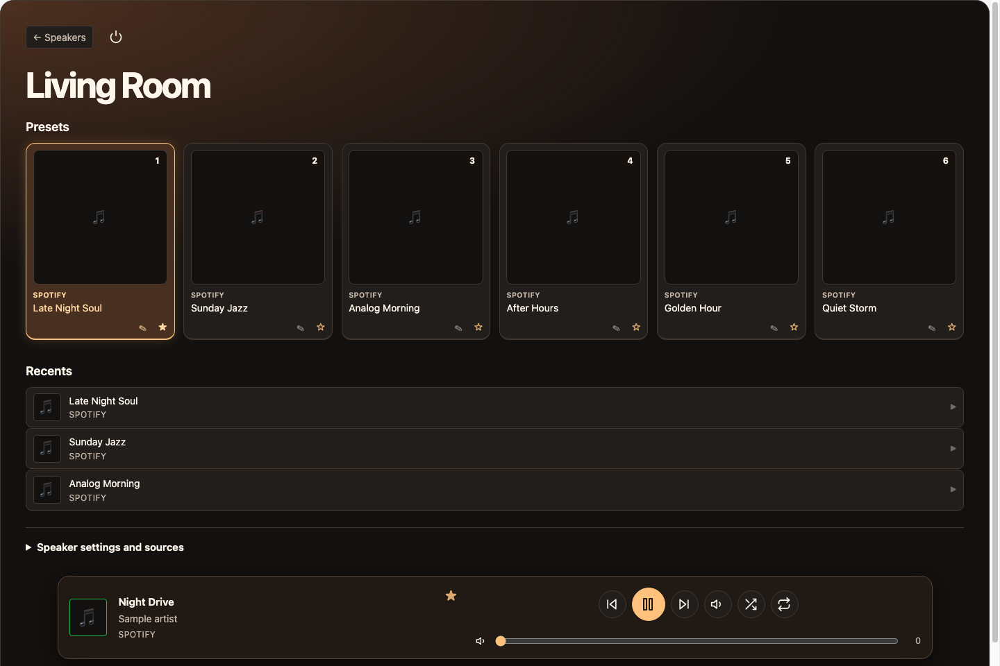
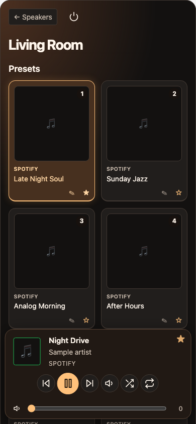

# Amber for AfterTouch

Amber is a UI overlay for [AfterTouch](https://github.com/gesellix/Bose-SoundTouch). It adds a charcoal and amber speaker view with artwork presets, recents, and persistent playback controls.





Screenshots use sample speaker and playlist data.

## Install with Docker

Amber is packaged for Docker and can be deployed on a Synology NAS through Portainer. The image bundles the Amber player with AfterTouch `v0.139.0` and supports AMD64 and ARM64.

For an existing Portainer stack, edit the AfterTouch service and replace its image line with the following. Keep your port mappings, environment, and data volume so the container can use your existing settings and presets.

```yaml
image: ghcr.io/artoodeetoo/amber-aftertouch-ui:0.1.1
```

If the package is private, configure Portainer to authenticate to `ghcr.io` before updating the stack. Once the container is running, open `http://<docker-host>:<published-port>/app/` and select your speaker. For a first-time setup, see the [AfterTouch deployment overview](https://gesellix.github.io/Bose-SoundTouch/docs/guides/DEPLOYMENT-OVERVIEW/).

## Build from source

The build checks out a pinned AfterTouch revision and embeds Amber in the player before building the container.

Run `sh prepare.sh` to fetch and patch the source. Then run:

```sh
docker build --target soundtouch-service -t amber-aftertouch-ui:local .aftertouch
```

To publish a version, push a tag such as `amber-v0.1.1`. GitHub Actions builds an AMD64 and ARM64 image. The workflow also supports manual dispatch for an existing Amber tag.

For an upstream update, revise the tag and commit in `prepare.sh`, refresh the UI patch against that revision, and verify the player before publishing a new Amber tag.

## Support

Report Amber UI bugs, ask setup questions, or suggest improvements in [Amber Issues](https://github.com/artoodeetoo/amber-aftertouch-ui/issues). Include your Amber version and, for layout bugs, your browser and screen size. For speaker migration or playback issues that also occur with the original player, use [AfterTouch Issues](https://github.com/gesellix/Bose-SoundTouch/issues).

## Contributing

Pull requests for the Amber UI and documentation are welcome. Open an issue first for larger changes so we can discuss the approach. If Amber is useful to you, a GitHub star helps others find it.

## Support Amber

If you enjoy the Amber interface and want to support its maintenance, you can [buy me a coffee](https://buymeacoffee.com/iceman008).

## Credits and license

Amber is an independent community UI overlay. Thanks to Tobias Gesellchen and the [AfterTouch contributors](https://github.com/gesellix/Bose-SoundTouch) for maintaining the software Amber builds on.

Amber is available under the [MIT license](LICENSE).
